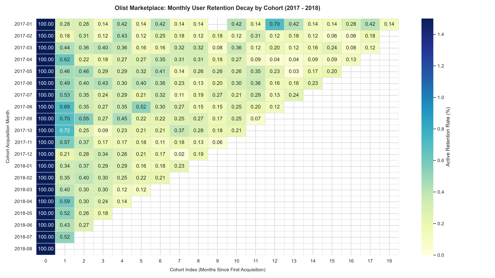
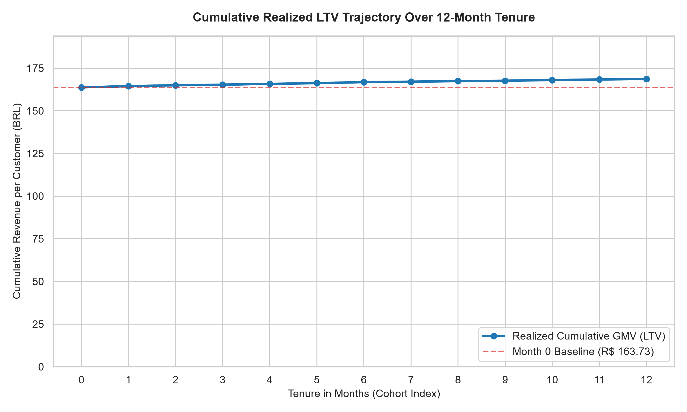

# Olist Marketplace: Strategic Unit Economics & Retention Architecture

An end-to-end analytical project assessing customer retention decay, 12-month realized lifetime value (LTV), and allowable Customer Acquisition Cost (CAC) thresholds across ~96,000 delivered orders on the Brazilian e-commerce platform Olist (2017–2018).

---

## 1. Executive Summary

* **One-and-Done Platform Reality:** Month 1 customer retention across all cohorts drops below **0.70%**, plateauing at **~0.20%–0.40%** through Month 12. Olist operates primarily as a high-intent acquisition channel rather than a repeat-purchase destination.
* **Frontloaded Value Realization:** **97.8%** of 12-month Gross Merchandise Value (GMV) per customer is realized during the initial purchase (Month 0). Repeat orders generate negligible incremental revenue over a 12-month horizon.
* **Strict CAC Ceiling:** Assuming a standard **15% marketplace take rate** and a target **3:1 LTV:CAC ratio**, the maximum allowable CAC is **R$ 8.16**. Any customer acquisition channel spending above this ceiling operates at a structural unit-level deficit unless order frequency or cross-selling is re-engineered.

---

## 2. Retention Decay Analysis

Across 2017 to 2018 monthly acquisition cohorts, customer tenure exhibits immediate attrition following the first delivery:



### Core Observations
* **Immediate Churn:** Across cohorts, 99.3%+ of newly acquired users do not make a second transaction within 30 days.
* **Stable Tail:** The small retained base (0.2%–0.5%) remains relatively consistent between Months 3 and 12, reflecting a tiny segment of recurring institutional or power buyers.
* **Marketing Implication:** Conventional retention marketing (e.g., blanket email campaigns, generic discounts) yields minimal marginal lift. Marketing spend must be evaluated against single-order payback rather than multi-year repeat assumptions.

---

## 3. Cumulative Realized LTV & Allowable CAC

Tracking mature cohorts (Jan 2017 – Aug 2017) across a full 12-month horizon reveals how cumulative spend evolves:



### Unit Economics Breakdown

| Metric | Value (BRL) | Description |
| :--- | :--- | :--- |
| **Month 0 GMV per Customer** | **R$ 159.95** | Baseline transaction value at acquisition |
| **12-Month Cumulative GMV (LTV)** | **R$ 163.53** | Total realized spend per customer after 12 months |
| **Incremental Repeat Contribution** | **R$ 3.58 (2.2%)** | Marginal GMV added from Month 1 to Month 12 |
| **Platform Take Rate (Assumption)** | **15.0%** | Estimated net marketplace commission |
| **Platform 12-Month Net Revenue** | **R$ 24.53** | `Cumulative GMV × 15%` |
| **Target LTV:CAC Ratio** | **3.0 : 1** | Sustainable growth benchmark |
| **Maximum Allowable CAC** | **R$ 8.16** | Upper limit on blended acquisition spend |

---

## 4. Strategic Recommendations

1. **Shift to Transactional Acquisition Discipline:** Underwrite paid acquisition channels strictly against **Day 0 gross profit contribution** rather than multi-year expected LTV.
2. **Category-Specific Subscription & Reorder Loops:** Repeat purchases are rare in durable goods (furniture, appliances). Re-engagement capital should focus selectively on fast-depleting consumables (beauty, health, pet care).
3. **Cross-Selling at Checkout:** Because secondary conversion is low, average order value (AOV) expansion must occur during the initial order flow (bundle recommendations, minimum order value thresholds for free delivery).

---

## 5. Repository Structure

```text
├── data/                  # Raw Olist CSV files (excluded via .gitignore)
├── notebooks/
│   └── 01_retention_and_ltv.ipynb   # Complete ETL, cohort modeling & visualization
├── reports/
│   └── figures/           # Exported visual deliverables
│       ├── olist_retention_heatmap.png
│       └── olist_cumulative_ltv_trajectory.png
├── .gitignore             # Data and environment exclusions
└── README.md              # Executive synthesis


